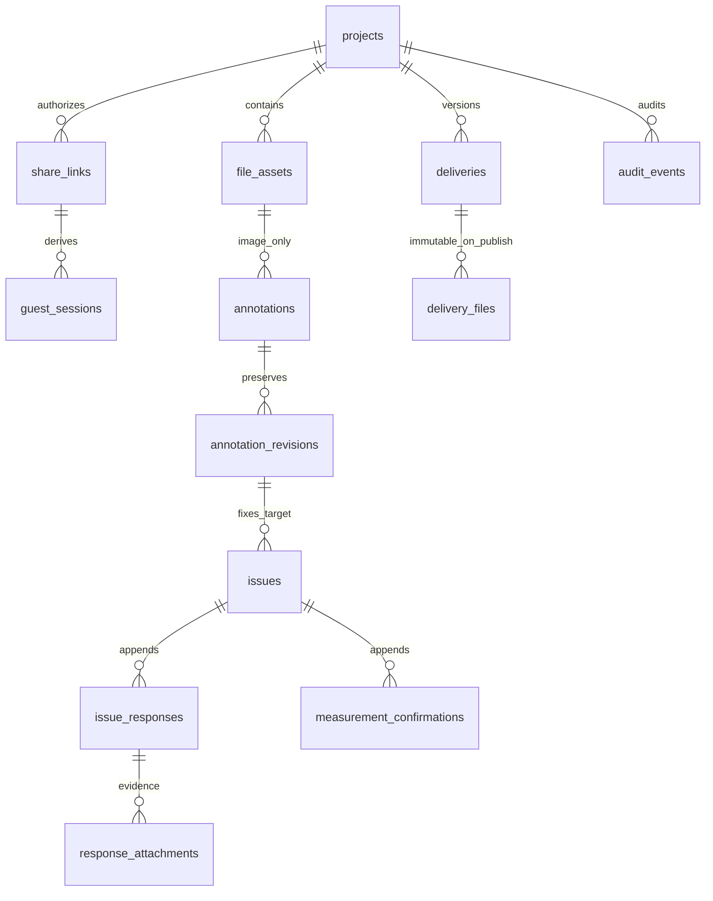

# 架构与安全基线 · 待审查

本文件及 `supabase/drafts/baseline.sql` 是方案，不是已上线能力。实现分期仍依 PRD P0-1～P0-4。数据库运行版本以未来选定 Supabase 项目为准（最低 PG15）；不假定本机 PG18 与托管版本等价。

## 模块和信任边界

```text
Owner/Guest Browser
  → Next.js Route Handlers / server-only DAL
  → 身份/能力校验 → Zod DTO → 业务事务 → 数据库 + 私有 Storage
```

| 模块（后续 src/modules） | 职责与依赖 |
|---|---|
| projects | Owner 归属、项目说明、归档；不转移 owner_id |
| share-access | 生成/哈希/撤销链接、Guest 会话，每次动作验证 |
| files | 上传预留、隔离校验、图像标准化、私有读取、逻辑删除 |
| annotations | 图片规范坐标、修订、乐观锁；仅 Owner 写 |
| issues | 请求、追加回复、重测和确认，引用固定 annotation revision |
| deliveries | 多附件草稿→原子发布；已发布版本与附件集合不可改 |
| audit / export（后续） | 无敏感原文的审计；导出只读一致性快照 |

Route Handler 只负责 DTO/会话/错误映射。授权集中到 server-only DAL，服务端客户端每请求创建，不共享用户 Cookie 状态。Owner 用官方 SSR cookie + `getClaims()` 验签；敏感管理动作同时 `getUser()` 获取新鲜用户状态，必要时核对服务端 session 是否仍有效。不能信任 `getSession()`、user_metadata 或前端传 ownerId。Next16 的 `proxy.ts` 只刷新会话，不作为唯一授权层。P0-0 尚无 proxy/Auth 实现。

多步骤事务不能串联多个 Supabase REST 调用冒充原子操作。后续选择单个受控 SQL RPC（默认 SECURITY INVOKER、非公开 schema、明确 EXECUTE 授权）或服务端 PG 事务适配器。若选 RPC，须重新审查 PostgREST schema 暴露配置；若选 PG，须固定驱动并核对 pooler/事务模式。当前草案无业务 RPC，普通数据库角色无写授权，不能直接用于业务上线。

收尾更新：明确推荐**服务端PG事务适配器**，具体runtime角色、事务上下文、pooler、校验/图像worker与孤儿清理见[ADR-01](08-runtime-decisions.md)。该选择待用户批准，前述两种方案不作为并存写入入口；SQL草案尚未按此批准方案更新或应用。

## 关系与历史



补充表：`guest_sessions`（独立随机会话哈希，引用链接）、`upload_reservations`（计入配额的在途字节与路径）、`idempotency_keys`（主体/动作/请求摘要/结果）、`delivery_feedback`（P2 留结构）。复合外键 `(project_id,id)` 防止 issue、回复、证据、交付串到其他项目；issue 还固定文件、annotation 与修订的三元关系。几何元数据 JSON 只用于有界几何/工程字段，其余实体真实关系化。SQL 草案中 JSON 的精细形状校验仍待 DTO 与数据库约束补齐，未获批准不可用于业务。

原文件存不可覆盖 UUID 路径，EXIF 归一化生成独立派生物；替换照片是新 file_id。annotations 当前头可更新，但每个版本入 `annotation_revisions`；issue 固定引用 revision，改标注不重写已发出的测量位置。回复/确认/审计只追加；更正用新记录与原因。issue 当前状态是索引方便的投影，其变更与追加审计同事务。发布后 delivery、delivery_files 由 trigger 拒绝改/删；新版本另开编号。

默认无物理 DELETE 权限，项目归档不等于删除。Owner 可逻辑隐藏未引用文件；已被 issue/response/delivery 引用的文件保留可见历史占位与附件内容，不允许静默隐藏已发布交付。Guest 不删除任何他人资料。删除请求先返回 `409 HISTORY_PROTECTED` 与引用计数；要隐藏当前列表须显式确认且不改变历史读取。保留期限建议：项目在账户有效期保留；终止服务后的导出缓冲 30 天（待批准/成本评估），不承诺无限存储；法定删除/清除需专门流程、墓碑和审计，不在 P0-0 实施。数据库备份与对象备份分别验证，PITR 不能恢复被删对象；归档/导出基于同一快照版本。

## 权限矩阵与 RLS

| 操作/对象 | Owner | Guest（有效链接且本项目客户可见） | anon/其他 Owner |
|---|---|---|---|
| 项目创建/说明/归档、链接管理 | 允许 | 拒绝 | 拒绝 |
| 上传资料、读资料 | 允许，受配额 | 允许，受配额与可见性 | 拒绝 |
| annotation/revision、请求创建/方法设置 | 允许 | 只读客户可见目标 | 拒绝 |
| 新回复和证据 | 允许 | 允许，不能覆盖历史 | 拒绝 |
| 确认/重测/人工最终值 | 允许 | 拒绝 | 拒绝 |
| 成果上传/发布 | 允许 | 拒绝 | 拒绝 |
| 已发布交付下载、反馈/接收 | 允许 | 允许（接收不等于技术验收） | 拒绝 |
| 文件软删除/历史管理 | 规则约束内允许 | 拒绝（V1 保守默认） | 拒绝 |
| share_hash、sessions、配额、幂等、审计写 | 仅受控服务动作 | 不直接访问 | 拒绝 |

RLS 草案采用**默认拒绝 + Owner SELECT**：`projects.owner_id = (select auth.uid())`；子表通过已索引 project FK 查归属；`share_links`/会话/上传预留/幂等只供服务端。`anon` 无业务表 grant，无 Guest DB JWT；Guest 只走后端，禁止匿名浏览器直接 Data API/Storage。`authenticated` 只有 Owner 所需 SELECT，无直接 INSERT/UPDATE/DELETE；事务写须未来明确授权服务适配层。所有业务表启用 RLS，服务端 service/secret 绕 RLS，因此其每个方法都要以已核验主体查询 project，不能把绕过 RLS 当权限控制。跨项目 ID 一律 404；已知无权动作 403，防止枚举。

草案 private Storage bucket `partmeasure-private`；浏览器角色不授 Storage 任何策略（默认拒绝）。Owner 也先经后端核权；这是有意比宽泛 owner 文件夹策略更严格。下载默认受控代理，每次核权并验证 file 状态/可见性/归属，支持 Range、固定 Content-Type、`attachment`、安全 filename、nosniff/no-store。经批准可用 60 秒签名下载减少服务流量，必须告知撤销后最长 60 秒残留且已下载内容不可收回；严格撤销要求用代理。不得公开 bucket 或使用永久 public URL。

## 分享验证、撤销与泄露控制

推荐 32 字节 CSPRNG token，base64url 43 字符，256-bit 熵；DB 存 SHA-256 摘要（高熵输入无需密码慢哈希）、到期/撤销时间，唯一索引。创建时只返回一次明文。GET `/s/[token]` 不产生业务写操作；客户端显式 POST bootstrap（可在页面加载后发起）才换取随机 HttpOnly、Secure、SameSite=Lax 的 Guest 会话 Cookie，保存其哈希及 share_link_id，有效 24h 且不超链接到期。原 URL 置换为同一动态路由下 `/s/session`（静态子路由优先）；这不是额外业务页。会话键设计按链接独立 Cookie/服务端 session selector，避免同浏览器开两个项目相互混淆；接口 URL 的项目标识只作选择器，再核 session.project_id。

每个 Guest 读取、上传预留/完成、回复、下载都 join 会话→链接→项目，检查全部未撤销/未过期，项目状态/visibility/action/file归属。链接建议默认30天到期（待审批），Owner 可提前撤销。撤销/重发在同一事务：锁项目→撤销现行链接及其会话→新哈希→审计；不单靠 Cookie 到期。并发写入与撤销都锁 share row，保证撤销提交后新写入不能越过；已开始传输/已下载字节无法追回，代理断开长传输按可行性评估，须明确边界。失败统一 `LINK_UNAVAILABLE`，不区分不存在/撤销/过期给陌生人。

原分享路径存在浏览器历史、接入层 URL 日志、预览爬虫泄露面。必须在主机访问日志/错误平台脱敏 `/s/*`，禁第三方分析/预览抓取、noindex、`Referrer-Policy: no-referrer`，不预加载私有资源；认证和分享响应 `private,no-store`、不放公共缓存/ISR，fetch no-store。后续生产启用 nonce CSP（self、必要 Storage 连接/图片来源，禁止 frame/object），HSTS 仅 HTTPS 环境。文字按文本转义，不渲染任意 HTML；文件名不作路径，限制名称长度与控制字符。Cookie 写接口校验 Origin/Host 与 CSRF token；CORS 仅同源，拒绝跨站写；OTP 回跳只允许站内白名单，无开放重定向。日志只存 requestId、动作、对象随机ID、状态和耗时，不记录 bearer、Cookie、signed URL、OTP 或回复正文。

## 事务、索引、幂等与限流

| 操作 | 单事务边界/并发 |
|---|---|
| annotation 保存 | 校验图片 ready → compare revision → 插修订→更新头→审计；409 避免覆盖 |
| 回复 | 锁 issue/链接→幂等占位→验证证据同项目ready→追加回复/附件→状态submitted→审计→结果 |
| 确认/重测 | 锁 issue，核 expectedRevision 和允许状态→追加 confirmation/事件→更新状态→审计 |
| 发布 | 锁项目编号计数/对应 delivery→校验全部附件ready→分配单调版本号→冻结集合→审计 |
| 上传预留 | 锁 project 配额→sum 已用+在途预算→预留不可重用路径；外部 Storage 不在 DB事务里 |
| 完成上传 | 外部校验/扫描/归一化成功→锁 reservation+project→复核链接→入ready资产→结算预算；失败补偿 |

不能在 DB 锁内等待网络上传。Storage/DB 用预留状态机与幂等补偿；删除对象走重试队列，失败不提前释放占用。上传临时超时/撤销后孤儿由受控定时清理，仍存在的授权窗口过后再回收预留字节。

索引：projects(owner_id,status,updated_at)；share token/session digest 唯一；file(project,created_at)；annotation(file_id) 与修订复合键；issue(project,status,created_at)；response(issue_id,created_at)；confirmation(issue_id,created_at)；delivery(project,version_no) 唯一；附件外键索引；audit(project,created_at)。所有 FK 有适当左前缀索引，审批后用真实量 EXPLAIN 验证，不预先加全文/GIN 无用索引。列表 keyset cursor `(created_at,id)`，上限100，默认30；不向 Guest 返回内部 hash、storage key、owner邮箱。

写操作要求 UUID `Idempotency-Key`，作用域为项目+已验证 actor（Guest 用会话ID）+动作。保存 canonical 请求 SHA-256；同键同载荷返回原结果，不同载荷409；并发唯一约束只产生一个结果。事务提交时结果与业务变更一起保存，至少24h保留；未知完成结果重试同键。429/5xx 若事务未提交可重试，不缓存永久失败。预留/完成各有独立键；保留 issued grant 与 reservation 记录，防止双计费。

限流提议（待成本/国内网络调优）：无效链接 IP 10次/分钟；有效会话读取120/分钟、回复20/分钟；上传预留10/分钟、并发每会话2个/每项目4个；Owner管理60/分钟、OTP请求3/10分钟并叠加 Supabase Auth 原有限流。组合 project+session+IP token bucket，分布式原子计数或数据库事务，不能用 serverless 进程 Map；429 + Retry-After。IP 只取可信代理，哈希短期保留；共享 NAT 不永久封禁，失败用退避。限流存储故障时敏感写 fail closed并提示重试，读取不绕过授权。

## 上传政策（建议值，需批准与部署实测）

| 类型 | 单文件上限 | 验证与呈现 |
|---|---|---|
| JPG/JPEG、PNG、WebP | 20 MiB、解码后≤40MP | 扩展名+真实magic+完整安全解码；EXIF标准化；不接SVG/GIF/HEIC，HEIC提示转JPG |
| PDF | 50 MiB | magic及安全扫描；首轮只下载/文件级问题，不嵌主动脚本 |
| STEP/STP、SLDPRT/SLDASM、STL、DXF/DWG | 100 MiB | 二进制签名或ASCII头结构有限嗅探+扫描；无法可靠确定则隔离/拒绝；不解析几何，不执行 |
| ZIP | 100 MiB | ZIP signature+扫描，禁止服务端自动解压/预览，不接受加密或多卷，检测宏/可执行文件策略另审 |
| 视频及其他格式 | 暂不开放 | 用户需要时另审成本/浏览器；不能默认放行任意 octet-stream |

每批≤20文件、项目1GiB（含派生图与隔离/在途预算）、Owner账户5GiB、项目每日上传500MiB，单张派生图预留最多80MiB预算；所有数值是可调提案而非已测服务承诺。bucket硬上限100MiB（实际套餐可能更低，先核对）；MIME allowlist只是第一层，不能信任浏览器声称的 MIME。CAD 允许 octet-stream 时必须由服务端二次嗅探，不能误认为桶 MIME 白名单已解决伪装。文件扫描引擎与隔离工作进程尚未选定，未落实不得对外开放Guest上传。解码限CPU/内存/时间和尺寸，拒绝炸弹、双扩展名和损坏图片；ZIP不解包，不宣称仅magic可识别恶意内容。

流程：核权→事务预留→服务端发只针对随机隔离路径的上传凭证（upsert=false）→直传/TUS→完成接口重新核权→实际字节/hash/magic/扫描→图片标准化→资产ready。不可用原文件名拼路径，不给客户端任意bucket/path。大于6MiB或弱网拟用TUS，6MiB chunk按官方当前要求；SDK上传签名有效期**固定2小时**，TUS上传URL可达24小时，不能伪称15分钟即可撤销。业务 reservation 可15分钟交互超时，但预算必须保留到所有底层凭证失效/孤儿清理后；撤销后禁止finalize或读取，已签凭证仍可能写入隔离区。这是存储残留窗口与成本风险，需真实测试。需要即时停止字节写入时采用支持短时凭证/逐请求撤销的上传代理或替代存储，先提交架构调整审批。下载签名有效期与上传凭证时效是两回事。

建议隔离对象满24h+缓冲1h后清理并结算；反复上传滥用的累计流量配额由网关/Storage事件计量，不能只按最终文件大小计算。预留总预算、限流、bucket上限不足以完全限制旧凭证重放成本，部署前必须验证实效并决定是否需要网关。ready资产持久化原件及派生图校验值，失败不创建可读记录。下载与预览只读ready；恶意/待查文件对所有Guest不可见。
